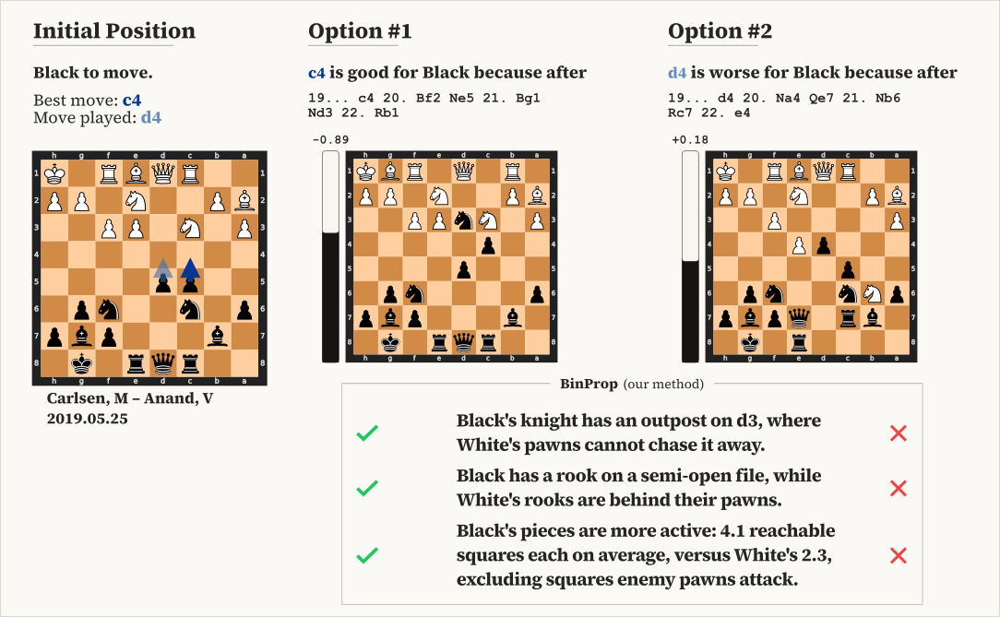

<h1 align="center">Explaining Chess and Go in Natural Language</h1>

<p align="center">
  <a href="https://oripress.com">Ori Press</a>
  &nbsp;&nbsp;·&nbsp;&nbsp;
  <a href="https://scholar.google.com/citations?hl=en&amp;user=rQ1T2-cAAAAJ&amp;view_op=list_works">Alexander Golubev</a>
</p>

<p align="center">
  <a href="https://nebius.com"></a>
</p>

<p align="center">
  <a href="https://arxiv.org/abs/2610.23166">Paper</a>
  &nbsp;·&nbsp;
  <a href="https://explainthatmove.com">Website</a>
  &nbsp;·&nbsp;
  <a href="https://explainthatmove.com/analysis">Explain your game</a>
  &nbsp;·&nbsp;
  <a href="https://explainthatmove.com/play">Test yourself</a>
</p>

<p align="center">
  BinProp uses language models to discover reusable chess and Go concepts and explain engine moves.
</p>

<p align="center">
  <picture>
    <source media="(prefers-color-scheme: dark)" srcset="docs/assets/figure-1-dark.svg">
    <source media="(prefers-color-scheme: light)" srcset="docs/assets/figure-1-light.svg">
    
  </picture>
</p>

<p align="center">
  <em>Figure 1. Black to move in Carlsen–Anand (2019). Stockfish recommends c4; Anand played d4.</em>
  Our method (BinProp) explains the difference using general chess concepts.
</p>

This repo includes discovery and inference code, plus the paper's **192 chess motifs and 250 Go motifs**.

## Quickstart

Python 3.10+, on Linux or macOS:

```sh
python -m venv .venv
. .venv/bin/activate
python -m pip install .
python examples/explain_chess.py
```

The example compares Stockfish's **30.Rf4** with Carlsen's **30.Rdf1** in
**Carlsen-Firouzja (2021)** using Opus 5 motifs. No engine or API key is needed.
For Go, run `python examples/explain_go.py`.

## Explain your positions

Supply positive and negative continuations in the [comparison format](docs/formats.md#inference-input-json):

```sh
binary-properties infer \
  --library chess/claude-opus-5 \
  --positions comparison.json \
  --output explanation.json
```

This returns up to three motifs, their descriptions and fit scores. It does not
calculate continuations. To save an example input, run
`python examples/explain_chess.py --write-comparison comparison.json`.

Use a [paper library](docs/motifs.md) or your own `basis.json` with `--library`.
`binary-properties libraries` lists all chess and Go libraries.

## Discover motifs

Supply a [winning/losing position pool](docs/formats.md#discovery-input-jsonl), separate from evaluation positions:

```sh
export NEBIUS_API_KEY='your-token-factory-key'
export MOTIF_MODEL='your-token-factory-model-id'

binary-properties discover \
  --game chess \
  --positions discovery.jsonl \
  --output runs/chess \
  --iterations 100
```

Use `--game go` for Go. Accepted motifs go in `basis.json`; proposal results go
in `iterations.jsonl`. See [provider options and resuming](docs/iteration.md).

Discovery sends board examples and code to the provider and makes paid API calls.
Run generated code in an isolated environment without secrets or network access;
the code checks are not a security sandbox.

## Paper experiments

[Run Direct and BinProp](experiments/README.md).
[Data collection](experiments/data.md), [formats](docs/formats.md) and
[selection and scoring](docs/method.md) are documented separately.

## BibTeX

```bibtex
@misc{press2026explaining,
  title         = {{Explaining Chess and Go in Natural Language}},
  author        = {Ori Press and Alexander Golubev},
  year          = {2026},
  eprint        = {2610.23166},
  archivePrefix = {arXiv},
  primaryClass  = {cs.CL},
  url           = {https://arxiv.org/abs/2610.23166}
}
```

## License

[MIT](LICENSE).
